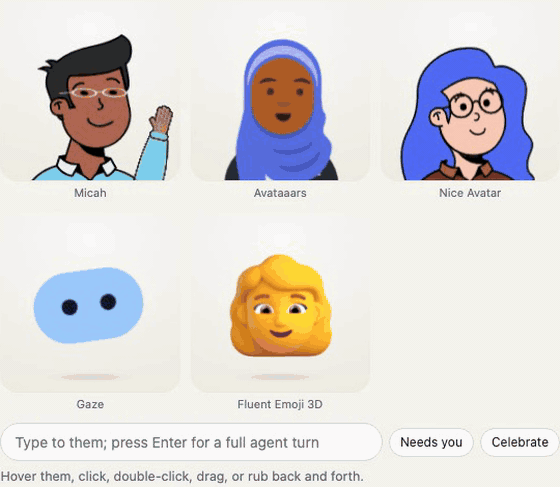
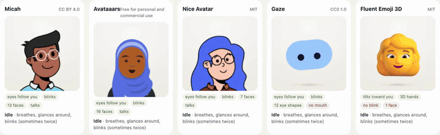
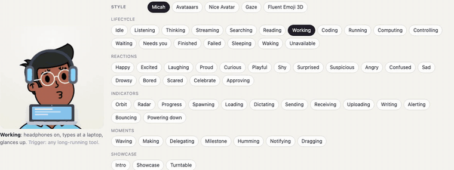
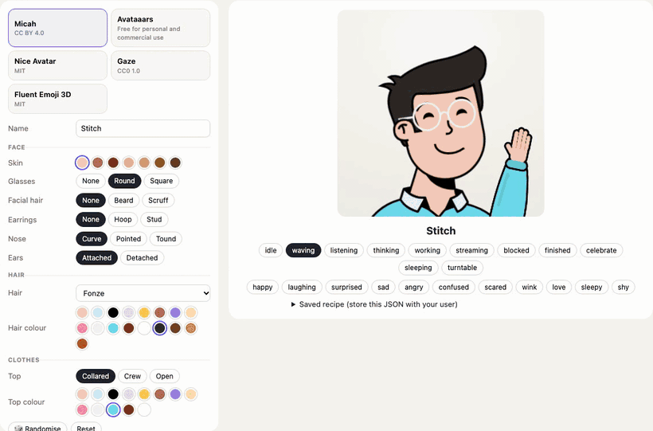
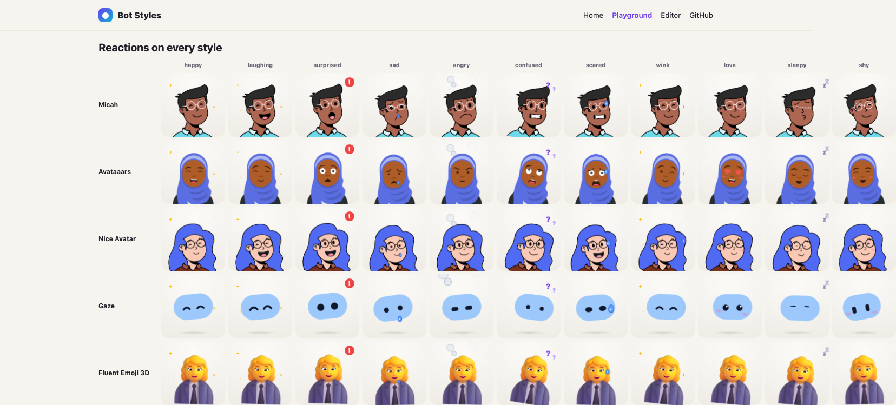
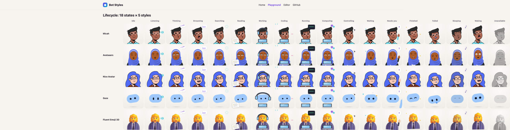
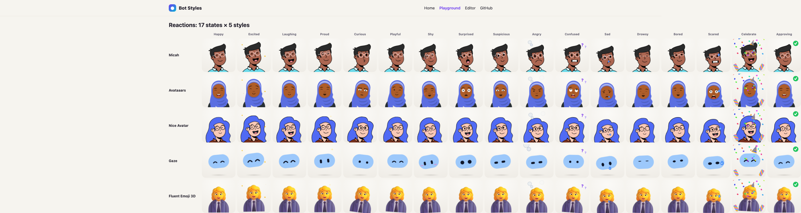
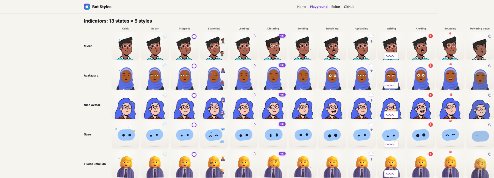
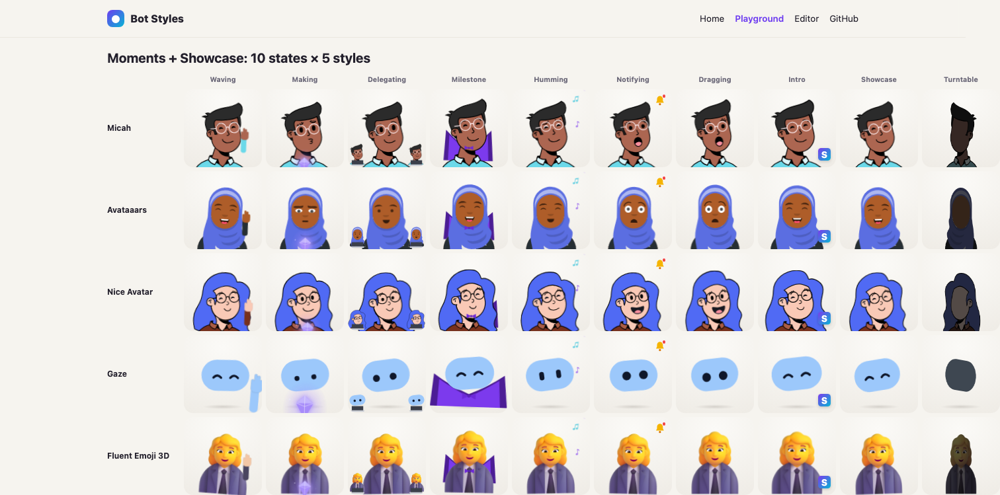
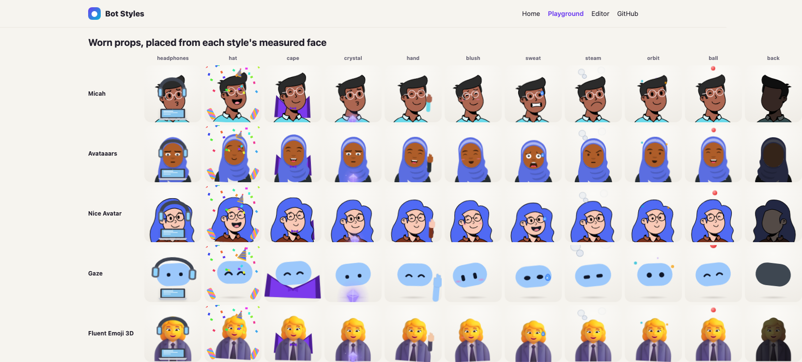

<div align="center">

# Bot Styles

**Make your AI agent feel alive.**

One open-source motion engine for agent avatars: **58 agent states**, reactions and interactions, on **hot-swappable avatar styles**.<br>
React · Next.js · Remix · Tauri · Electron · plain DOM. Core is ~22 KB gzipped with zero dependencies.

[**Live playground**](https://bot-styles.stitchable.ai/playground.html) · [Editor demo](https://bot-styles.stitchable.ai/editor.html) · [Docs](docs/) · [Add it to your agent](#for-coding-agents)



</div>

## Why

Agents spend most of their time doing things you cannot see: reasoning, calling tools, waiting on you. A spinner says *busy*. A face can say **thinking, reading, coding, needs you, done, asleep** at a glance, and it makes the agent feel like someone you work with.

Agent companions like that have shown up inside recent AI products, but each one is a closed, single-character implementation. There are many good open-source avatar *art* libraries, and none of them move. Bot Styles is the missing layer in between:

- **Motion is shared, art is swappable.** One engine plays every state on every style. Change the look with `avatar.setArt()` and the behaviour stays exactly the same.
- **Built on the commons.** It animates existing open-source avatar systems (DiceBear's styles, react-nice-avatar, Fluent Emoji) instead of shipping yet another character. Any picture works too.
- **Made for agents.** States map to what agents actually do, and `agentPresence()` wires them to your events in a few lines. A coding-agent skill installs it for you.
- **Small, polite, portable.** Plain DOM + CSS, SSR-safe, one shared animation loop, pauses off screen, respects reduced motion, namespaced CSS.

## See it

| Interactions are built in | Hot-swap the style, keep the state |
|---|---|
|  |  |

| An editing interface every style implements | Reactions read on every style |
|---|---|
|  |  |

<details>
<summary><b>All 58 states on all five styles</b> (click to expand)</summary>







</details>

## Quick start

```sh
npm i bot-styles @dicebear/core @dicebear/styles
```

**React, Next.js, Remix** (`bot-styles/react` ships `"use client"`; the server renders an empty, sized box):

```tsx
import { AgentAvatar, useStyleArt } from "bot-styles/react";
import { micah } from "bot-styles/styles/micah";

export function Bot({ state }: { state: string }) {
  const art = useStyleArt(micah);                  // or useStyleArt(micah, savedOptions)
  return <AgentAvatar art={art} state={state} size={160} />;
}
```

**Plain DOM, Tauri v2, Electron, Vue, Svelte:**

```ts
import { createAvatar } from "bot-styles";
import { gaze } from "bot-styles/styles/gaze";

const avatar = createAvatar(document.querySelector("#bot")!, await gaze.render(gaze.defaults()));
avatar.setState("thinking");     // any of the 58 states
avatar.react("happy");           // a short reaction over any state
avatar.look("left");             // turn the head
```

More: [frameworks and hosts](docs/frameworks.md) (Tauri WebViews, Electron, strict CSP, SSR).

## Wire it to your agent

```ts
import { agentPresence } from "bot-styles";

const bot = agentPresence(avatar);                          // an avatar, an array, or (state) => setState(state)
composer.addEventListener("input", () => bot.typing());     // listening, then idle after a pause
onSubmit(() => bot.sent());                                 // nods, a paper plane, then thinking
agent.on("reasoning", () => bot.thinking());
agent.on("tool_call", (call) => bot.tool(call.name));       // web_search → searching, read_file → reading,
                                                            // edit_file → coding, bash → running, computer → controlling
agent.on("text_delta", () => bot.streaming());              // it talks
agent.on("approval_required", () => bot.needsInput());      // hand up; drowsy after 2 minutes
agent.on("done", () => bot.done());                         // double spin, sparkles, then idle
agent.on("error", () => bot.error());
```

## What's in it

| | |
|---|---|
| **58 states** in 5 groups | **Lifecycle** (idle, listening, thinking, streaming, searching, reading, working, coding, running, computing, controlling, waiting, needs you, finished, failed, sleeping, waking, unavailable) · **Reactions** (happy, excited, laughing, proud, curious, playful, shy, surprised, suspicious, angry, confused, sad, drowsy, bored, scared, celebrate, approving) · **Indicators** (orbit, radar, progress, spawning, loading, dictating, sending, receiving, uploading, writing, alerting, bouncing, powering down) · **Moments** (waving, making, delegating, milestone, humming, notifying, dragging) · **Showcase** (intro, showcase, turntable). Full table: [docs/states.md](docs/states.md). |
| **Motion** | ~60 keyframe clips; several per state, shuffled, never the same twice in a row, blended into each other. States hand off on their own (finished → idle, needs you → drowsy, bored → asleep). Faces change mid-blink. The mouth moves while streaming. Pokes: spin, bounce, nod, wiggle, shake, jolt. |
| **Interactions** | Eyes, then head, follow the pointer (parallax makes flat art feel 2.5D). Click to hop, double-click to spin, drag to make it dangle and swing, rub to make it blush, click five times to annoy it. Leave it alone and it gets bored, then sleeps; hover wakes it with a stretch. |
| **Props** | Laptop and headphones, thought dots, radar, terminal, a cursor its eyes follow, party hat and confetti, a cape, a glowing crystal, little helper copies of itself, and more. Drawn by the app, so every style gets them. Register your own. |
| **Courtesy** | One `requestAnimationFrame` loop for all avatars; stops off screen and in hidden tabs; `prefers-reduced-motion` gives a still pose; under 56 px it plays gentle clips and shows badges only. |

## Styles

Each style is its own import, so you only ship what you use. The art libraries are optional peer dependencies.

| Import | Art | Licence | Gzipped |
|---|---|---|---|
| `bot-styles/styles/micah` | [Micah](https://www.figma.com/community/file/829741575478342595) by Micah Lanier, via DiceBear | CC BY 4.0 (attribution required) | 9.2 KB + DiceBear core 24.9 KB |
| `bot-styles/styles/avataaars` | [Avataaars](https://avataaars.com/) by Pablo Stanley, via DiceBear | Free for personal and commercial use | 41.7 KB + DiceBear core |
| `bot-styles/styles/gaze` | [Gaze](https://www.dicebear.com) by DiceBear | CC0 1.0 | 3.6 KB + DiceBear core |
| `bot-styles/styles/nice` | [react-nice-avatar](https://github.com/dapi-labs/react-nice-avatar) by Dapi | MIT | 34.6 KB (+ your React) |
| `bot-styles/styles/fluent` | [Fluent Emoji 3D](https://github.com/microsoft/fluentui-emoji) by Microsoft | MIT | 1.1 KB (images from a pinned CDN commit, or self-host) |
| `bot-styles` | the engine: motion, props, CSS | MIT | **21.8 KB**, no dependencies |
| `bot-styles/react` | React bindings | MIT | +0.4 KB |

### Bring your own style

A style is anything that returns faces (SVG or images) and a few hints, and parts tagged `bs-part-eyes`, `bs-part-mouth`… move on their own.

```ts
import { pictureStyle } from "bot-styles";
import { dicebearStyle, variantField } from "bot-styles/dicebear";
import lorelei from "@dicebear/styles/lorelei.json";

export const mascot = pictureStyle({ id: "mascot", name: "Our mascot", src: "/mascot.png",
  credit: { author: "Our design team", license: "Proprietary" } });

export const loreleiStyle = dicebearStyle({                 // any of DiceBear's 60+ styles
  id: "lorelei", name: "Lorelei", definition: lorelei,
  fields: [variantField(lorelei, "hair", "Hair")],
  defaults: () => ({ seed: "Ada", hairVariant: "variant05" }),
  faces: { neutral: { mouthVariant: "happy01" }, happy: { mouthVariant: "happy08" }, talk: { mouthVariant: "happy05" } },
  art: { parallax: { eyes: 6, mouth: 3 } },
});
```

Guide: [docs/styles.md](docs/styles.md). Motion is data too: add states, change timings or write clips with [docs/motion.md](docs/motion.md).

**Community styles.** Publish a package named `bot-styles-style-<name>` exporting an `AvatarStyle`, then open a PR to list it here. None yet: be the first.

### Build your own editor

Every style exposes the same editing interface: `fields` (select, colour, toggle, text), `defaults()` and `render(options)`. Your app owns the editor UI; a user's avatar is a small JSON recipe you store anywhere:

```json
{ "v": 1, "style": "micah", "options": { "baseColor": "#ac6651", "hairVariant": "fonze", "glassesVariant": "round" }, "name": "Stitch" }
```

[examples/react-editor](examples/react-editor) is a complete editor built only from that interface ([try it](https://bot-styles.stitchable.ai/editor.html)).

## For coding agents

Install the skill into Claude Code, Codex, Cursor and other agents with one command:

```sh
npx skills add Stitchable-ai/open-stitch-bot-styles
```

Then ask your agent: *“Add an animated avatar for our agent with bot-styles, and drive it from our chat events.”* The skill ([skills/bot-styles](skills/bot-styles/SKILL.md)) tells it how to find your framework and agent events, install the right peers, mount the avatar, wire `agentPresence`, and keep the art credits.

## Examples

| | |
|---|---|
| [examples/vanilla](examples/vanilla) | no framework; the same code runs in Tauri and Electron (`npm run dev:vanilla`) |
| [examples/react-editor](examples/react-editor) | an avatar editor template (`npm run dev:editor`) |
| [examples/nextjs](examples/nextjs) | App Router client component |
| [site](site) | the playground and landing page (`npm run dev`) |

## Thank you

Bot Styles animates art made by other people, and it would not exist without them. If you ship a style, keep its credit.

- **[DiceBear](https://www.dicebear.com)** by **Florian Körner** and contributors (MIT). DiceBear 10's data-only style definitions are what let us tag eyes, brows and mouths in any style without forking a single drawing.
- **Micah** by **[Micah Lanier](https://dribbble.com/micahlanier)**, the “[Avatar Illustration System](https://www.figma.com/community/file/829741575478342595)” (CC BY 4.0), remixed by DiceBear.
- **[Avataaars](https://avataaars.com/)** by **[Pablo Stanley](https://twitter.com/pablostanley)** (free for personal and commercial use), remixed by DiceBear.
- **Gaze** by **DiceBear** (CC0 1.0).
- **[react-nice-avatar](https://github.com/dapi-labs/react-nice-avatar)** by **Dapi** (MIT).
- **[Fluent Emoji](https://github.com/microsoft/fluentui-emoji)** by **Microsoft** (MIT).
- Built with [Vite](https://vite.dev), [esbuild](https://esbuild.github.io), [React](https://react.dev), [TypeScript](https://www.typescriptlang.org) and tested with [Playwright](https://playwright.dev).

The library ships no third-party art: styles import it from the original packages or load it from the original source. The demo images in `media/` and on the website show that art under the licences above. Notices: [THIRD_PARTY_NOTICES.md](THIRD_PARTY_NOTICES.md).

## Contributing

Styles, states, clips, props, framework wrappers (Vue, Svelte, Solid) and fixes are all welcome. See [CONTRIBUTING.md](CONTRIBUTING.md).

```sh
npm ci && npm run build && npm test          # library + unit tests
npm run build:site && npm run test:browser   # site + end-to-end checks in Chromium
npm run dev                                  # playground at localhost:5173
```

## License

The engine is [MIT](LICENSE). Each art style keeps its own licence (see the table above).

Made by [Stitchable](https://stitchable.ai) and contributors.
